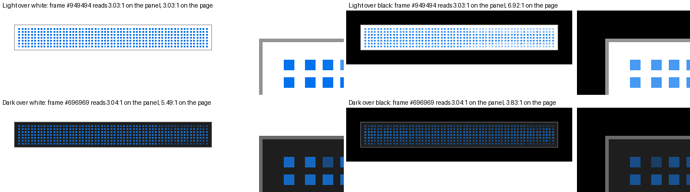

# macOS HUD in Cantrip's Omarchy look — 2026-11-02

Sanitized evidence for `feat/macos-hud-omarchy`. No transcript text from a real
person or private audio is recorded here: speech is the public
`samples/jfk.wav`, and the dummy endpoint answers with that public sentence.

## Setup

- **Build:** `python3 scripts/package-macos --target aarch64-apple-darwin --ad-hoc`
  from `3625fd0` (`source_tree_dirty: false`), installed in a disposable
  `macvm` guest (macOS 27.0, 26A428, 1440×900 at 1x).
- **Audio:** BlackHole 2ch from Homebrew, `audio_source = "BlackHole2ch_UID"`,
  system output routed to BlackHole, `afplay samples/jfk.wav`. Microphone access
  granted with `cantrip microphone allow` and the Allow button.
- **States:** a local dummy OpenAI-compatible endpoint at `127.0.0.1:9900`
  that never answers (processing), answers with the JFK sentence (handoff
  sent), or is absent (connection refused: the failure). `[handoff.pepper]`
  (label "Kaylee") runs a script that discards the text and fails while a flag
  file exists (handoff failure). Takes were driven with `cantrip start`,
  `start --handoff pepper`, `stop` and `cancel`.
- **Backdrops:** Safari zoomed over the screen with a plain white (#ffffff) or
  black (#000000) page. Light and Dark were switched in System Settings →
  Appearance.
- **Captures:** guest `screencapture`, cropped to the same 416×200 box around
  the panel at native 1x pixels.
- **Linux:** `cantrip hud --screenshot … --state …` from the same tree, built
  on a Boat worker (Ubuntu 24.04, x86_64) and rendered by the real Wayland
  layer surface in headless sway at scale 1. Themes are Omarchy's
  `tokyo-night` and `catppuccin-latte` `colors.toml` at basecamp/omarchy
  `a69b19f`. The renders are the layer surface's own pixels, shown over flat
  gray. They are the production fixtures the HUD gallery replays. `3625fd0`
  changes no Linux color, so these renders from `04e6fcd` still apply.

## The frame

Each panel in the default flow with its top-left corner enlarged 6×
([compare-frame.png](compare-frame.png)). Every pixel of the frame's 1-point
ring is one color. Ratios are WCAG contrast against the panel's surface just
inside the ring and the page just outside it.

| Appearance | Frame | On the surface | On a white page | On a black page |
| --- | --- | --- | --- | --- |
| Light | #949494 | 3.03:1 (#ffffff) | 3.03:1 | 6.92:1 |
| Dark | #696969 | 3.04:1 (#1e1e1e) | 5.49:1 | 3.83:1 |
| Light, handoff to Kaylee | #c621dd | 3.75:1 (wash #f8e4fb) | 4.50:1 | 4.66:1 |
| Dark, handoff to Kaylee | #db34f2 | 4.06:1 (wash #352137) | 3.63:1 | 5.79:1 |

The same values were measured in the recording, processing and failure
captures. Before `3625fd0` the default frame was AppKit's separator color,
#e6e6e6 in Light (1.25:1 on the surface and on a white page) and #343434 in
Dark (1.34:1). The macOS palette now fits that frame token to 3:1 against its
surfaces by changing only lightness.

On Linux the same token comes from the Omarchy theme's `muted` color and is
drawn as the theme gives it: #414868 on #1a1b26 in Tokyo Night and #acb0be on
#eff1f5 in Catppuccin Latte, both 1.91:1 on the surface.

## Side by side

Each sheet: top row macOS Light over a white page, over a black page, and
Linux Catppuccin Latte; bottom row macOS Dark over a black page, over a white
page, and Linux Tokyo Night.

| State | Sheet |
| --- | --- |
| Recording | [compare-recording.png](compare-recording.png) |
| Processing (transcribing) | [compare-processing.png](compare-processing.png) |
| Failure (cloud refused, no local model) | [compare-failure.png](compare-failure.png) |
| Handoff recording, "to Kaylee" | [compare-handoff-recording.png](compare-handoff-recording.png) |
| Handoff processing | [compare-handoff-processing.png](compare-handoff-processing.png) |
| Handoff failure (receiver exits 1) | [compare-handoff-failure.png](compare-handoff-failure.png) |
| Handoff sent, "Sent to Kaylee." | [compare-handoff-sent.png](compare-handoff-sent.png) |
| Failure auto-hide | [failure-auto-hide.png](failure-auto-hide.png) |
| Full screen, downscaled to 50% | [Light](context-light-failure.png), [Dark](context-dark-failure.png) |

The Linux `handoff-sent` fixture paints the frame before the success result is
presented (full field, no caption), so that column is not the same moment as
the macOS capture.

## Measured on the live panel

- **Square corners.** Differencing each capture against the same page without
  the panel gives exactly the container rectangle, 336×44 to 336×160 points;
  nothing outside it changes, including the panel's clear margins. Every corner
  pixel is the frame, route or attention-rail color; none shows the page.
- **Opaque surface.** The failure and handoff-failure containers are
  pixel-identical over the white page and over the black page: 0 of 53,760 and
  0 of 48,384 pixels differ, in Light and in Dark.
- **Contrast of the drawn colors** (pixels the painter fills completely;
  measured on the `04e6fcd` captures, whose surfaces and colors `3625fd0`
  leaves unchanged):

  | Color | Light | Dark |
  | --- | --- | --- |
  | Attention rail and action line on the surface | #be5900 on #ffffff, 4.55:1 | #ff9230 on #1e1e1e, 7.47:1 |
  | Attention on a handoff's wash | #ab5000 on #f8e4fb, 4.51:1 | #ff9230 on #352137, 6.61:1 |
  | Field, fully lit | #0072ef on #ffffff, 4.51:1 | #1183ff on #1e1e1e, 4.54:1 |
  | Handoff field, fully lit, on the wash | #b11ec6 on #f8e4fb, 4.52:1 | #df4af3 on #352137, 4.50:1 |

  Without the wash fit, the Light attention color #be5900 would read 3.79:1 on
  that wash. Glyph pixels at 1x are antialiased, so their darkest pixel
  understates the text color: title lines measured 14.55:1 (Light) and 12.16:1
  (Dark) on the surface, and 12.11:1 and 10.65:1 on the wash; the 10–11 px
  label and action lines measured 3.4–4.4:1 at their darkest pixel. Their
  colors are fitted to 4.5:1 by
  `a_handoff_take_reads_at_4_5_to_1_on_its_washed_surface`.
- **Focus** (`04e6fcd`). `lsappinfo front` named Safari while idle, while
  recording, while the failure showed and after it hid.
- **Failure auto-hide.** In all four backdrop runs the failure was on screen
  2.5 s after `stop` and gone at 12 s, while `cantrip status` still reported the
  undismissed failed outcome.

## Not verified here

- A Retina (2x) display: this guest runs at 1x.
- macOS 13.3–15. The panel no longer uses any API newer than 13.3; the build's
  minimum stays 13.3.
- Increase Contrast and Reduce Transparency, which no longer change the panel's
  backdrop; Increase Contrast still changes the AppKit colors it resolves.
